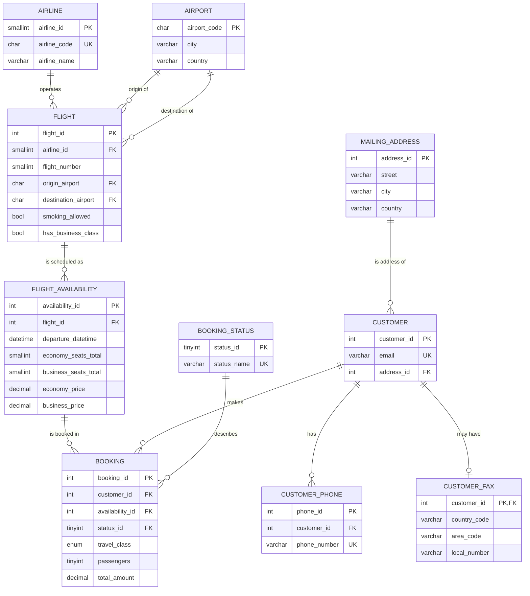

# Airline Reservation Database (MySQL)

A relational database for an African airline reservation company. It stores airlines, airports, flights and their dated departures, customers (with addresses, phones and fax), and bookings. Seat availability, pricing and overbooking protection are handled inside the database itself.

It is a redesign of a university group project. The original had seven tables with no foreign keys. This version is fully linked, normalised and enforces its own business rules.

**Tech:** MySQL 8.0.16+ · SQL (DDL, DML) · views · stored function · stored procedures · triggers · transactions

---

## Files

| File | Purpose |
|---|---|
| `01_schema.sql` | Creates the database, 10 tables, 3 views (plus 1 helper view), 1 function, 2 triggers, 2 procedures |
| `02_sample_data.sql` | Loads fictional sample data (8 airlines, 11 airports, 10 flights, 12 departures, 8 customers, 13 bookings) |
| `03_sample_queries.sql` | 10 reporting queries and 7 demos of the business rules |

**How to run:** in MySQL Workbench or the `mysql` client, run the three files in order:

```bash
mysql -u root -p < 01_schema.sql
mysql -u root -p < 02_sample_data.sql
mysql -u root -p < 03_sample_queries.sql
```

---

## Entity-relationship diagram



---

## How the tables fit together

The idea is simple: a **customer** books seats on a **dated departure** of a **flight**.

1. **`airline`** and **`airport`** are reference tables, identified by their real IATA codes (KQ, NBO).
2. **`flight`** is a route product, such as "KQ 101, Nairobi to Accra". It links to an airline and to two airports (origin and destination). It carries the smoking and business-class indicators from the original design.
3. **`flight_availability`** is one dated departure of a flight (KQ 101 on 5 November at 08:00). It holds the departure and arrival times, the seat capacity for each class, and the ticket price for each class.
4. **`customer`** links to a **`mailing_address`**. Phones live in **`customer_phone`** (many per customer) and the optional fax in **`customer_fax`** (at most one per customer).
5. **`booking`** is the centre of the model. It links the customer, the departure and a **`booking_status`** (booked, cancelled or scratched), and records the class, the number of passengers and the price.

### Relationship summary

| Relationship | Type | Delete rule |
|---|---|---|
| airline → flight | 1 : many | restrict |
| airport → flight (origin, destination) | 1 : many, twice | restrict |
| flight → flight_availability | 1 : many | restrict |
| flight_availability → booking | 1 : many | restrict |
| customer → booking | 1 : many | restrict |
| booking_status → booking | 1 : many | restrict |
| mailing_address → customer | 1 : many | restrict |
| customer → customer_phone | 1 : many | cascade |
| customer → customer_fax | 1 : 0..1 | cascade |

"Restrict" means you cannot delete a record that other records depend on, so history can't be lost by accident. Phones and fax are deleted along with their customer.

---

## What I changed from the original project, and why

| Original | Problem | Now |
|---|---|---|
| No foreign keys; tables were unconnected | Nothing linked a customer to a booking or flight | Every relationship is a real foreign key |
| `customers` primary key was the phone number | One phone per customer, and the key changes if the number does | Surrogate `customer_id`; phones in their own table |
| `total price` keyed on the price, holding only a first name | Two equal prices collide; the customer link was a text guess | Price, tax and total are columns of `booking` |
| `flight` primary key was `Airline_code` | An airline could have only one flight | Own `flight_id`, unique `(airline, flight number)` |
| Booked and available seat counts stored separately | They can contradict each other (they did in the sample data) | Only capacity is stored; booked and available are calculated |
| Arrival and departure copied into `booking` | Same fact stored twice | Stored once in `flight_availability` |
| Status as free text | Typos possible | `booking_status` lookup table |
| City and "state" as free text in the customer row | Repeated, inconsistent data | Separate `mailing_address` table |
| "Calc total price" and "Calc tax" only on the class diagram | Not implemented | Implemented in a trigger |

These changes bring the design to roughly third normal form: each fact is stored in one place, and every non-key column depends on its table's key.

---

## Business rules built into the database

- **`fn_seats_left(departure, class)`** returns how many seats remain, by subtracting active bookings from capacity.
- **`trg_booking_before_insert`** runs before every new booking. It rejects the booking if there aren't enough seats. It also looks up the price, then calculates base amount, 16% tax and total, so the application can't submit a wrong price.
- **`trg_booking_before_update`** allows only the status to change. The flight, class and passengers are locked (cancel and rebook instead), and prices stay frozen. Re-activating a cancelled booking is allowed only if seats are free again.
- **`sp_book_flight`** is the safe way to book. It locks the departure row inside a transaction so two customers can't take the last seat at the same moment.
- **`sp_cancel_booking`** sets a booking to cancelled, which frees its seats.
- **Views:** `v_flight_availability` (a search-ready flight list with seats left), `v_booking_details` (one readable row per booking), `v_customer_contacts` (address, phones and fax in one row), and `v_seat_usage` (a helper for the others).
- **Constraints:** `CHECK` rules (arrival after departure, origin ≠ destination, prices positive, 1–9 passengers), unique emails and unique flight numbers per airline.

### Design decisions worth mentioning

- **Derived data isn't stored.** Booked seats are calculated, so they can never drift out of sync.
- **Prices are frozen at booking time.** A later fare change doesn't alter existing bookings.
- **Flight vs. departure.** `flight` is the reusable route; `flight_availability` is one dated instance. That's why one flight number can run on many dates.
- **Seats are held only by status "booked".** Cancelled and scratched bookings release their seats.

---

## Sample queries

`03_sample_queries.sql` includes:

- searching departures with seats left and prices
- finding sold-out flights
- a customer's booking history
- revenue per airline
- bookings by status
- load factor (percentage of seats sold)
- repeat customers
- customers per country
- live demos of booking, cancelling, overbooking rejection, foreign-key rejection and frozen prices

Example:

```sql
-- Revenue per airline (active bookings only)
SELECT al.airline_name, COUNT(*) AS bookings, SUM(b.total_amount) AS revenue_usd
FROM booking b
JOIN flight_availability fa ON fa.availability_id = b.availability_id
JOIN flight f  ON f.flight_id   = fa.flight_id
JOIN airline al ON al.airline_id = f.airline_id
WHERE b.status_id = 1
GROUP BY al.airline_id, al.airline_name
ORDER BY revenue_usd DESC;
```

---

## Assumptions

- Prices are in USD per passenger. Times are stored as UTC.
- The 16% tax is a flat demo rate hard-coded in the trigger.
- "Scratched" means removed from the list by the airline (for example a no-show or flight change). "Cancelled" means cancelled by the customer.
- All people, emails and phone numbers are fictional.

## Ideas for extending it

- A `passenger` table (names and passport details per seat) and a `seat` table for seat selection
- A `payment` table linked to `booking`, with a payment status
- An `aircraft` table to drive seat capacity automatically
- Connecting a small web front end or a Python/Node API on top
